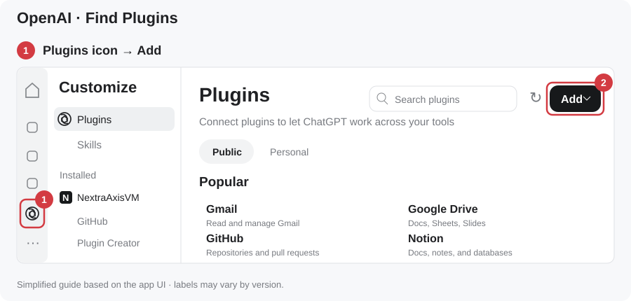
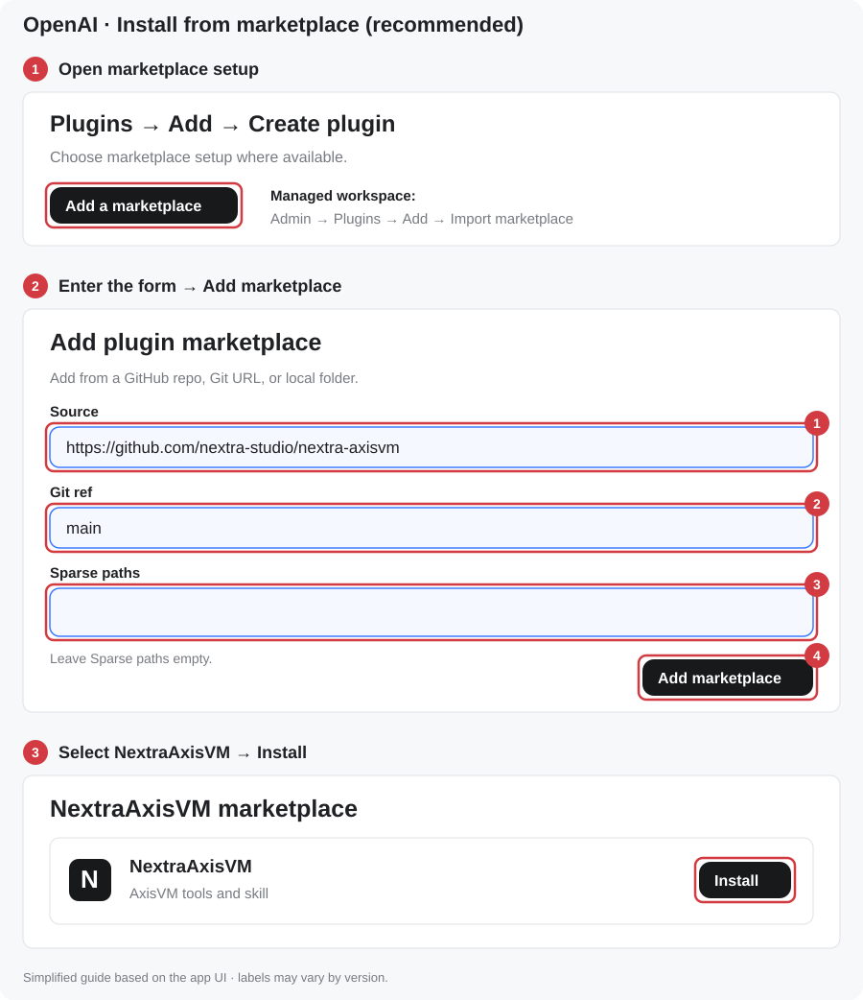
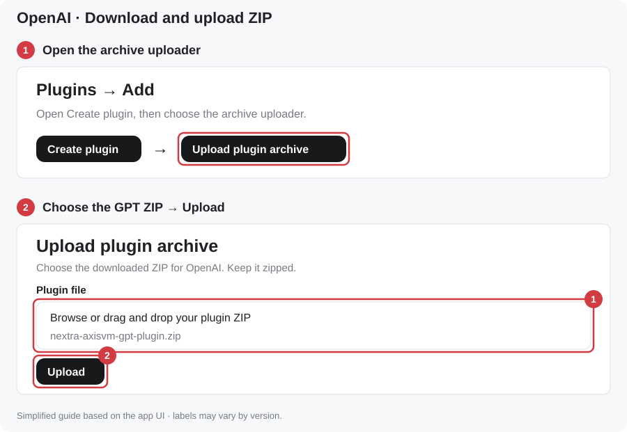
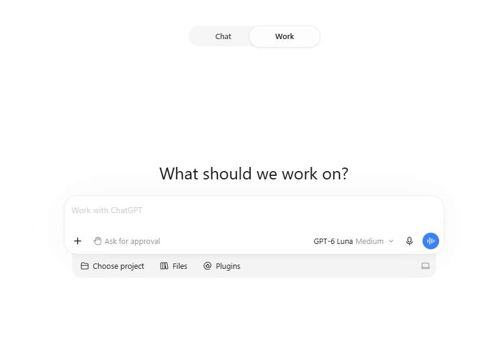
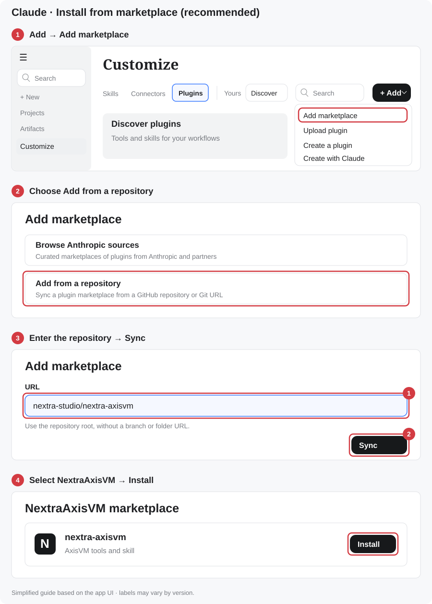
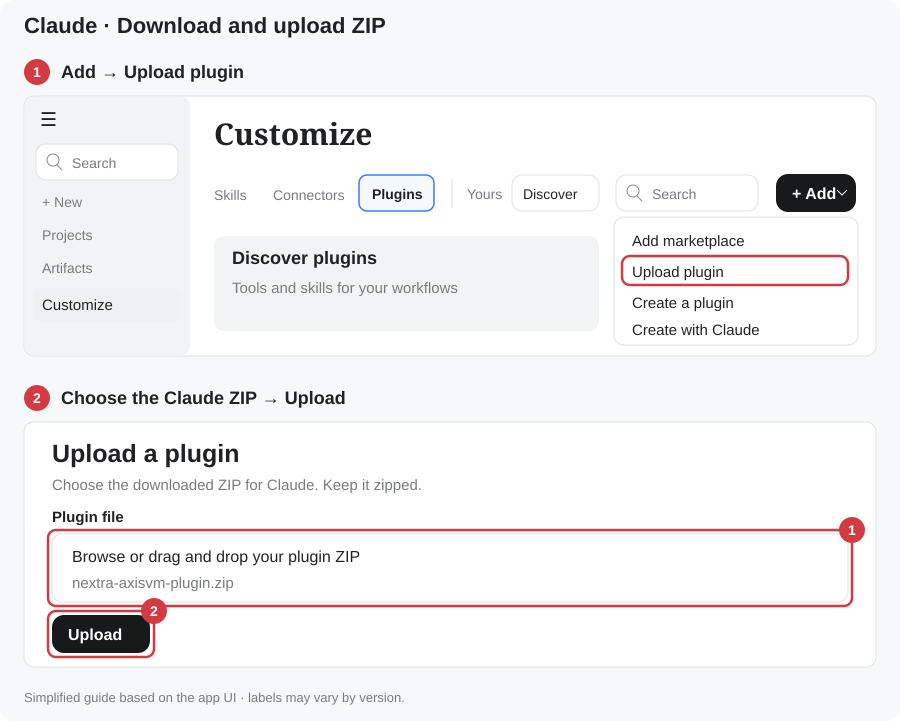

# NextraAxisVM: AxisVM for AI agents

Six token-lean tools let an LLM read, build, analyse and change AxisVM models, including **the model you already have open**. It works from ChatGPT desktop / Codex, Claude Desktop, Claude Code, or any MCP client. It is built on [PyAxisVM](https://axisvm.github.io/pyaxisvm-docs/) and has the same structure as [NextraRhinoGh](https://github.com/nextra-studio/nextra-rhinogh). Replies state what changed, pictures carry tags the model can point at, and every change is one AxisVM undo step.

**[Install from the marketplace](#install)** · **[Download Claude ZIP](https://github.com/nextra-studio/nextra-axisvm/releases/latest/download/nextra-axisvm-plugin.zip)** · **[Download ChatGPT/Codex ZIP](https://github.com/nextra-studio/nextra-axisvm/releases/latest/download/nextra-axisvm-gpt-plugin.zip)**

## Install

### 1. Your AI app

Choose your AI app below. For ChatGPT/Codex and Claude, **install from this GitHub marketplace** for the easiest update path, or **download the ZIP**. Both install the same plugin; pick one.

```text
https://github.com/nextra-studio/nextra-axisvm
```

The pictures are simplified guides of the app menus. Labels can vary by version.

<details open>
<summary><strong>ChatGPT / Codex desktop</strong></summary>

**Find Plugins:** click the **Plugins icon** in the far-left navigation rail, then click **Add** at the top right.



<details open>
<summary><strong>Install from marketplace (recommended)</strong></summary>

1. Open **Add → Create plugin → Add a marketplace** where available.
2. Fill in **Add plugin marketplace** exactly as below, then click **Add marketplace**:

   | Field | Enter |
   |---|---|
   | **Source** | `https://github.com/nextra-studio/nextra-axisvm` |
   | **Git ref** | `main` |
   | **Sparse paths** | Leave empty |

3. Open **NextraAxisVM**, select **NextraAxisVM**, and click **Install** (or **+**).



If your app has no **Add a marketplace**, run `codex plugin marketplace add nextra-studio/nextra-axisvm` in a terminal, restart the app, then install **NextraAxisVM** from the Plugins Directory.

</details>

<details>
<summary><strong>Download and upload ZIP</strong></summary>

1. **[Download the ChatGPT/Codex plugin ZIP](https://github.com/nextra-studio/nextra-axisvm/releases/latest/download/nextra-axisvm-gpt-plugin.zip)**. Keep it zipped.
2. From **Add**, open **Create plugin → Upload plugin archive** (or **Upload plugin**).
3. Select `nextra-axisvm-gpt-plugin.zip` and finish the installation.



</details>

Start a new session in **Work** (or Codex) on the desktop app. **Use Work, not Chat**: plugin tools do not run in Chat. Type `@NextraAxisVM` and your request.



</details>

<details>
<summary><strong>Claude Desktop</strong></summary>

**Find Plugins:** **Customize** in the left sidebar → **Plugins** → **+ Add**.


<details open>
<summary><strong>Install from marketplace (recommended)</strong></summary>

1. Choose **+ Add → Add marketplace → Add from a repository**.
2. Enter `nextra-studio/nextra-axisvm` in **URL**, then click **Sync**.
3. Open the **NextraAxisVM** marketplace, select **nextra-axisvm**, and click **Install**.



</details>

<details>
<summary><strong>Download and upload ZIP</strong></summary>

1. **[Download the Claude plugin ZIP](https://github.com/nextra-studio/nextra-axisvm/releases/latest/download/nextra-axisvm-plugin.zip)**. Keep it zipped.
2. Choose **+ Add → Upload plugin**, select `nextra-axisvm-plugin.zip`, then **Upload**.



</details>

Start a new **Cowork** session. In the first message of each session, start with `/nextra-axisvm`.

</details>

<details>
<summary><strong>Claude Code</strong></summary>

```text
claude plugin marketplace add nextra-studio/nextra-axisvm
claude plugin install nextra-axisvm@nextra-axisvm
```

Or download the Claude ZIP, extract it, and start `claude --plugin-dir PATH_TO_EXTRACTED_PLUGIN`.

</details>

<details>
<summary><strong>Other AI agents</strong></summary>

**[Download the agent kit ZIP](https://github.com/nextra-studio/nextra-axisvm/releases/latest/download/nextra-axisvm-agent-kit.zip)** (skill, MCP server, Setup.bat, workspace configuration). Extract it, run `Setup.bat`, and open the folder as your agent's workspace. Details are in `AGENTS.md`.

</details>

### 2. AxisVM side: automatic

**Nothing to type in a terminal.** The first time the AI uses NextraAxisVM, the plugin sets up everything in the background (about 1–4 minutes):

- Python 3.10 with **PyAxisVM**, in `%LOCALAPPDATA%\NextraAxisVM\venv` (pinned versions; your own Python is not touched),
- the **NextraAxisVM add-on** in AxisVM's `AddOns` folder,

then **restart AxisVM once**. From then on, every AxisVM you open connects automatically. A **Nextra AI** item in AxisVM's add-on menu shows the connection state.

Prefer to install it beforehand? **[Download NextraAxisVM-Setup.zip](https://github.com/nextra-studio/nextra-axisvm/releases/latest/download/NextraAxisVM-Setup.zip)**, extract it, and **double-click `Setup.bat`**. It shows each step and asks for administrator rights only if AxisVM's folder is not writable.

### Try it

Open AxisVM first (any model, or an empty one), then:

| App | Message |
|---|---|
| ChatGPT / Codex desktop (**Work**) | `@NextraAxisVM Build a two-bay steel frame with a concrete slab in AxisVM and analyse it` |
| Claude Desktop (Cowork) / Claude Code | `/nextra-axisvm Check the model I have open in AxisVM and summarise the results` |

<details>
<summary>Troubleshooting</summary>

| Problem | Fix |
|---|---|
| "installing its Python environment" | First use. Wait 1–4 minutes and ask again. Then restart AxisVM once. |
| "AxisVM is running but the add-on is not loaded" | Restart AxisVM. If that does not help, run `Setup.bat` (it reports where the add-on went), then restart AxisVM. |
| "not reachable" although AxisVM is open | AxisVM and the AI app run at different privilege levels (one "as administrator"). Start both normally. |
| A call hangs | AxisVM is showing a dialog. The AI sees it with `query {scope:'status'}` (with a screenshot). Answer the dialog in AxisVM. |
| No tools in the AI app | Confirm the plugin is installed, restart the app, start a new session (ChatGPT: **Work**, not Chat). |
| Several AxisVM windows | Name the file: "Use bridge.axs." |
| Setup failed | Double-click `Setup.bat` and read the message. Log: `%LOCALAPPDATA%\NextraAxisVM\setup.log`. |

</details>

## Tools

| tool | what it does |
|---|---|
| `view` | Picture of the model with an 8×8 grid and short handle tags (`n5` node, `l12` line, `d3` domain). Crowded views return per-cell counts, then `focus:'C3:E5'` zooms in. Results as pictures: deformed shape, members coloured by `Nx/Vz/My/Mz`. `target:'axisvm'` captures AxisVM's own window (its contours and result displays). |
| `query` | Text, cheapest first. **Model:** summary → one line per element (section, material, nodes, length, orientation) → detail (releases, loads, contour). **Loads**, **results** (displacements, reactions with sum, member and surface force extremes), **catalog** (sections/materials), **api** (exact signatures, records and enums of *your* AxisVM's COM type library), docs, library, **status** (dialogs with screenshots, even while AxisVM is busy), instances. |
| `edit` | A compact **shorthand**: one line per action for members, slabs/walls/shells, holes, supports, releases, load cases, loads, combinations, set/delete/select. `@ x=0:6:24` repeats lines. Members are split at shared nodes so the structure connects. Also analysis, DXF/IFC/AXS/PDF import, **Rhino import**, DXF/IFC export, open/save. |
| `run` | Python with PyAxisVM on the open model, with helpers (`kit`, `h('l3')`, `q('type:beam')`). Supports patch edits, reports the model delta, and adds a checkpoint. |
| `undo` | Revert to a checkpoint through AxisVM's own undo (also Ctrl+Z in AxisVM). It refuses if you changed the model in AxisVM meanwhile. |
| `memory` | Your preferences and workflows, learned rules (user-approved), mistake log, script library. |

Example `edit`, a complete frame in 12 lines:

```text
use mat=S 235
sec COL = HEB 200
sec BM = IPE 300
column 0,0,0 0,0,3.5 sec=COL @ x=0:6:12 y=0,5
beam 0,0,3.5 12,0,3.5 sec=BM @ y=0,5
beam 0,0,3.5 0,5,3.5 sec=BM @ x=0:6:12
slab 0,0,3.5 12,0,3.5 12,5,3.5 0,5,3.5 t=0.2 mat=C30/37
support z=0 fixed
case G self
case Q
load Q d1 pz=-3
combo ULS = 1.35 G + 1.5 Q
```

The full AxisVM COM API (204 interfaces, ~5,000 methods) is **not** turned into tools: too many tools confuse a model and cost tokens on every request. The common modelling path is one `edit`. Everything else goes through `run`, guided by `query {scope:'api'}`, which serves exact signatures from the installed version.

### Rhino → AxisVM

`skill/nextra-axisvm/rhino/rhino_export.py` runs inside Rhino 8 (with [NextraRhinoGh](https://github.com/nextra-studio/nextra-rhinogh) or Rhino's ScriptEditor). It writes the AxisBridge JSON. `edit {import:'…json'}` builds the model with the same AxisModelBuilder as the *N. Rhino Import* add-on, now running headless inside the NextraAxisVM add-on (node merging, intersections, catalog lookups, supports, releases and loads from `Ax_*` user texts, one undo step).

### What is possible, and what is not

See [dev/PLAN.md](dev/PLAN.md). In short:
- **Possible:** the open model, several instances, modelling, loads, linear analysis, results, import/export, Rhino import, undo, pictures, setup without a terminal.
- **Not possible / out of scope:** attaching without the add-on (AxisVM does not register itself for COM clients), answering AxisVM dialogs silently, more than one model per AxisVM window, and shorthand for design checks (use `run`).

## Testing

`python test/regress.py --launch` starts a separate AxisVM and runs the regression suite through the MCP bridge, the same path an AI app uses. It has **34 steps, all passing**, including hand-calculation checks: frame + slab self-weight (323 kN), ULS combination (706.2 kN = 1.35 G + 1.5 Q), and a simply supported beam (reactions 90 kN, max moment PL/4 + qL²/8 = 140 kNm).

## Your own instructions

The folder `%APPDATA%\NextraAxisVM\user` holds `preferences.md` (read every session), `workflows/*.md` (index at session start, opened when the request matches), and `scripts/` (run by name). The AI saves lasting preferences and verified workflows there. Plugin updates never touch it.

**Config** (`%APPDATA%\NextraAxisVM\config.json`, optional): `python` (interpreter), `user_dir`, `memory_dir`, `library_dirs`, `mesh_size` (default mesh size in m), `api_text` (path to a text export of the AxisVM COM PDF; its paragraphs are appended to API answers), `skill_dir`.

## Repository

```
addon/NextraAxisVM   C# add-on (.NET 4.8): registers AxisVM for the tools at start-up (ROT); headless Rhino import
addon/bin            built NextraAxisVM.dll (committed; setup copies it into AxisVM\AddOns)
engine/              Python worker: conn (attach/instances), query, edit (shorthand), run, undo, view, memory, apidocs, comkit
bridge/              MCP stdio server (zero-dependency Node) + .mcpb manifest; supervises the worker, runs setup on first use
setup/               setup.ps1 + pinned requirements (Setup.bat at the root)
skill/nextra-axisvm  SKILL.md, shorthand.md, workflows.md, api/axisvm-com.md, rhino/rhino_export.py
plugin/              generated by tools/make_plugin.py: one plugin for Claude Code/Desktop and Codex/ChatGPT
.claude-plugin/      Claude marketplace catalog · .agents/plugins/  OpenAI marketplace catalog
tools/               make_plugin.py (plugin + dist/ releases), nx.py (MCP test client), install_diagrams.py
test/                regress.py (live regression suite)
dev/                 PLAN.md (architecture, scope, limits), PROGRESS.md
```

<details>
<summary>Maintainers: build and publish</summary>

1. Add-on: `cd addon/NextraAxisVM && dotnet build -c Release` (output `addon/bin/NextraAxisVM.dll`, needs AxisVM installed for the interface DLL; override with `-p:AxisVMDir=…`).
2. Bump the version in `bridge/manifest.json`, `bridge/server/index.js`, `engine/nextra_axisvm/core.py` and `addon/NextraAxisVM/Host.cs` + `.csproj`.
3. `python tools/make_plugin.py`. Commit `plugin/`, `.claude-plugin/` and `.agents/`.
4. `python test/regress.py --launch`.
5. `gh release create v<ver> dist/nextra-axisvm-plugin.zip dist/nextra-axisvm-gpt-plugin.zip dist/nextra-axisvm-agent-kit.zip dist/nextra-axisvm-<ver>.mcpb dist/nextra-axisvm-skill.zip dist/NextraAxisVM-Setup.zip`

Keep the ZIP file names stable so the download links keep working.

</details>

## License

[Apache License 2.0](LICENSE). PyAxisVM is MIT-licensed by InterCAD. AxisVM is a product of InterCAD; NextraAxisVM is an independent project.
